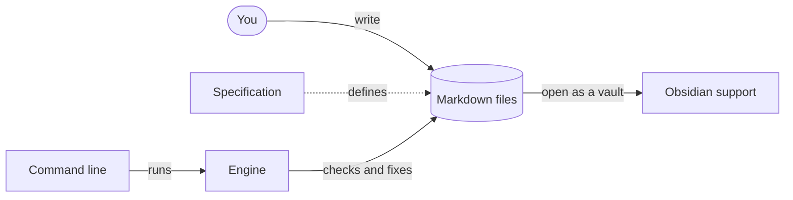

# idk-plans

<!-- idk-plans:progress:start (generated) -->
◐ 75% (25/33) · 4 deferred
<!-- idk-plans:progress:end -->

Keep your project's architecture and progress in Markdown files next to the code. idk-plans checks the files, keeps their generated parts current, and builds a website from them. Progress rolls up from tasks to the top of the project.

- **[Specification](./SPEC.md "spec")**: the format. Start here.
- **Status:** 0.1.0 draft. The format can change.
- **Demo:** these docs use idk-plans. Run `npx idk-plans site` in this repository, then open `_site/index.html`.



<!-- idk-plans:zoom:start (generated) -->
Zoom in: [Specification](./SPEC.md "spec") · [Command line](./bin/README.md "cli") · [Engine](./src/README.md "engine") · [Obsidian support](./obsidian/README.md "obsidian")
<!-- idk-plans:zoom:end -->

## What it does

- Each doc page has an `id` and a `parent`, so the pages make a tree.
- A page can also be in other trees, such as a "concerns" tree. It uses dot-separated paths: `parents: { concern: security.peer-auth }`.
- Tasks are checkboxes: `[ ]` todo, `[/]` doing, `[x]` done, `[>]` deferred, `[-]` dropped. `#blocked` on an open task makes it blocked. Progress rolls up through every tree.
- Links carry ids: `[Trust store](../trust/README.md "trust-store")`. You type `[trust-store]`, and the tool writes the path. It corrects the path when files move, so links work on Codeberg, GitHub, and Obsidian without a site.
- Generated blocks show progress, child pages, and diagram links. The Markdown stays readable without the tool.
- For Obsidian, `fix` writes each page's place in every tree as nested tags, and adds page titles to `aliases`.

## Parts

<!-- idk-plans:children:start (generated) -->
- [Specification](./SPEC.md "spec"): The format of idk-plans files. It defines nodes, trees, tasks, rollups, links, generated blocks, and the checks. · no tasks · 3 deferred
- [Command line](./bin/README.md "cli"): Runs the commands check, fix, tree, model, and site. It is the only part that reads arguments and writes to the terminal. ◐ 66% (2/3)
- [Engine](./src/README.md "engine"): Reads the Markdown files, builds one model of all nodes, trees, and tasks, and checks and fixes the files from that model. ◐ 87% (21/24) · 1 deferred
- [Obsidian support](./obsidian/README.md "obsidian"): Lets you read and edit the docs in Obsidian, with working links, backlinks, tags for each tree, and distinct task marks. ◐ 66% (2/3)
<!-- idk-plans:children:end -->

## Other views

<!-- idk-plans:trees:start (generated) -->
**Viewers** ◐ 72% (13/18) · 1 deferred

- [Obsidian support](./obsidian/README.md "obsidian") ◐ 88% (8/9) · 1 deferred
  - [Fix](./src/fix.md "fix") ● 100% (4/4)
  - [Prose unwrap](./src/wrap.md "wrap") ● 100% (2/2) · 1 deferred
- [Site builder](./src/site.md "site") ◐ 50% (3/6)
  - [Publish the site](./docs/publish-site.md "publish-site") ○ 0% (0/1)
- Forges ● 100% (4/4)
  - [Fix](./src/fix.md "fix") ● 100% (4/4)
- Terminal ◐ 66% (2/3)
  - [Command line](./bin/README.md "cli") ◐ 66% (2/3)
<!-- idk-plans:trees:end -->

## Use

```sh
npm install --save-dev idk-plans

npx idk-plans check    # report problems (CI, pre-push)
npx idk-plans fix      # update generated blocks (pre-commit)
npx idk-plans tree     # show progress in the terminal
npx idk-plans tree --tree concern
npx idk-plans model    # the whole model as JSON
npx idk-plans site     # build the static site into _site/
```

The configuration is `idk-plans.config.json` in the project root. See section 9 of the [Specification](./SPEC.md "spec").

## Git hooks

```sh
# .githooks/pre-commit
npx idk-plans fix && git add -u

# .githooks/pre-push
npx idk-plans check --quiet
```

Turn them on with `git config core.hooksPath .githooks`.

## Viewers

- **Obsidian:** see [Obsidian support](./obsidian/README.md "obsidian").
- **The site:** `idk-plans site --out _site` builds a static site. To put it on Codeberg Pages, see [Publish the site](./docs/publish-site.md "publish-site").

## Tasks

- [ ] Publish the repository on Codeberg
- [ ] Publish the package on npm
- [ ] Publish version 1.0 of the format
