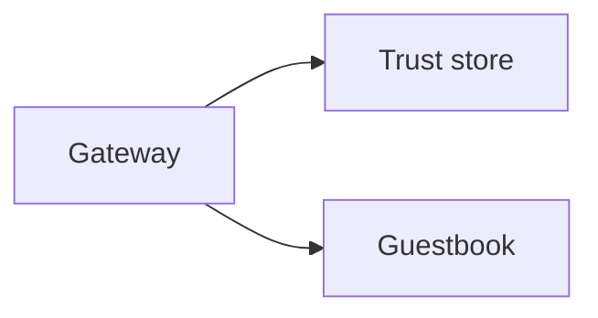

# idk-plans specification

**Version:** 0.1.0-draft · **Status:** draft, expect breaking changes

idk-plans is a convention for keeping a project's architecture and progress
in plain Markdown files that live next to the code. A tool reads those files,
checks them, keeps generated parts current, and can build a website from them.

The files stay useful without the tool. Any Markdown viewer (Codeberg, GitHub,
Obsidian, an editor) shows readable text, working links, and current progress.

## 1. Goals

1. A reader can understand the whole system from the top page alone, and can
   open more detail when they need it.
2. Each concept has exactly one home page. Other pages link to it.
3. Every page can be reached from the root page.
4. Progress is recorded only on tasks. Pages show progress that the tool
   calculates from the tasks below them.
5. One page can appear in more than one tree (for example, "parts of the
   system" and "security concerns").
6. The source files are Markdown, YAML frontmatter, and Mermaid. People can
   read and edit them without the tool.
7. The tool can find stale or broken content before it is pushed.

## 2. Terms

| Term | Meaning |
|---|---|
| **node** | One Markdown file that has an `id` in its frontmatter. |
| **id** | The stable name of a node. A short, readable stub, such as `trust-store`. |
| **tree** | One way to arrange nodes, such as `system` or `concern`. Each tree has a name. |
| **primary tree** | The tree that gives each node its home. It sets the breadcrumbs and the site URL. |
| **parent** | The node directly above a node in a tree. |
| **path** | A list of ids, separated by dots, from the top of a tree down to a node. Example: `security.peer-auth`. |
| **virtual node** | A node that a path names but no file defines. The tool creates an index page for it. |
| **task** | One checkbox list item in a node's body. |
| **rollup** | The progress of a node: the tasks it owns plus every task below it in a tree. |
| **generated block** | Part of a file that the tool writes. Marked with HTML comments. |

## 3. Nodes

A Markdown file is a node when its frontmatter has an `id`. The tool ignores
Markdown files without frontmatter `id`, except the root (see 3.4).

### 3.1 Where nodes live

Put a node next to what it describes:

- For a module or directory, use that directory's `README.md`. Codeberg and
  GitHub show this file when you open the directory.
- For a concern that has no single directory, put the file in a docs folder
  (for example `docs/concerns/security.md`).

The configuration (section 9) sets which files the tool scans.

### 3.2 Frontmatter

```yaml
---
id: trust-store                 # required, unique in the project
title: Trust store              # required
summary: >-                     # required, one or two plain sentences
  Keeps the list of peers that you trust, and their public keys.
parent: gateway                 # required, except on the root
parents:                        # optional, positions in other trees
  concern: security.peer-auth
kind: module                    # optional, see 3.3
status: todo                    # optional, see 5.4
code:                           # optional, paths from the project root
  - gateway/server/src/trust/
aliases: [trusted peers]        # optional, other names for search and the glossary
order: 2                        # optional, position among siblings
---
```

**id**

- Lowercase letters, digits, and single hyphens: `^[a-z0-9]+(-[a-z0-9]+)*$`.
- Unique in the project, across all trees.
- Do not change an id after other pages link to it. If you must change it, the
  `fix` command updates the links (see 7.2).

**title**: short name for headings, links, and diagrams.

**summary**: the plain-language description of the node. See section 6.

**parent**: the id of the parent in the primary tree. Every node except the
root must have one. Short for `parents.<primary tree>`.

**parents**: a map from tree name to a parent reference in that tree. See
section 4.

**order**: a number that sets the position of the node among its siblings.
Siblings with an order come first, from low to high. The other siblings follow,
sorted by title.

**aliases**: other names for the node. `fix` adds the `title` to `aliases`
when it is not there, so that tools which show file names (for example
Obsidian, where many pages are `README.md`) can find the page by its title.

**code**: files or directories that this node describes. Paths start at the
project root. The tool reports paths that do not exist.

### 3.3 Kinds

`kind` is optional. It changes how the site shows a node and which checks
apply. It does not change rollups.

| Kind | Use for |
|---|---|
| `system` | The root, or a whole deployable thing. |
| `module` | A part of the code with clear edges. |
| `feature` | Something a user can do. |
| `concern` | A topic that crosses modules, such as security. |
| `guide` | Instructions for people, such as setup steps. |
| `reference` | Facts to look up, such as a protocol format. |
| `plan` | Work that is not finished yet. See section 8. |

If you do not give a kind, the node is a `module` when it has a `code` field,
and a `reference` when it does not.

### 3.4 The root

The project has one root node: the top of the primary tree. The root is
usually the project `README.md`.

The root can have frontmatter like any other node. If you do not want
frontmatter in the README, set `root` in the configuration. The tool then
treats that file as a node with the id from the configuration and the title
from its first heading.

## 4. Trees

### 4.1 Tree names

The configuration lists the trees. One of them is the primary tree. If the
configuration lists no trees, there is one tree, named `system`, and it is
primary.

A tree name follows the same rules as an id. In the primary tree, the top is
the root. In each other tree, the top is a virtual node whose id is the tree
name, unless a real node has that id.

### 4.2 The primary tree

- Each non-root node has exactly one primary parent.
- The primary tree must have no cycles.
- Each node must reach the root through its primary parents.

Together these rules mean that every node can be reached from the root, and
every node has one home.

### 4.3 Other trees

A node can be in any other tree. Use `parents`:

```yaml
parents:
  concern: security.peer-auth          # one parent
  journey:                             # more than one parent
    - onboarding.add-a-friend
    - recovery
```

In trees other than the primary tree, a node can have more than one parent.
The first parent is the one that the site uses for breadcrumbs.

A node that is not in a tree is not shown in that tree. That is valid.

### 4.4 Paths

A parent reference is a path: ids separated by dots. The last id is the
parent. The ids before it are that parent's parents, from the top down.

- `peer-auth` means: the parent is `peer-auth`.
- `security.peer-auth` means: the parent is `peer-auth`, and the parent of
  `peer-auth` is `security`.

A path does not have to start at the top of the tree. The first id in a path
keeps the position that other nodes or paths give it.

The tool checks each path:

- If a node with an id in the path exists and gives its own parent in that
  tree, the path must agree with it. If it does not, that is an error
  (`path-mismatch`).
- If a node with an id in the path exists but does not give its own parent in
  that tree, the path gives it its parent. All paths that name the node must
  agree, or that is an error (`path-mismatch`).
- If a node is a parent in a tree but nothing gives its own parent there, it is
  at the top level of that tree.
- If no node has that id, and some path in the project has more than one id
  and includes it, the tool makes a **virtual node** with that id. Its title
  comes from the id (`peer-auth` becomes "Peer auth"). Its page lists its
  children.
- If no node has that id, and the configuration declares it as a group of
  that tree (section 9), the tool makes a virtual node for it too.
- If no node has that id, no longer path includes it, and no group declares
  it, that is an error (`missing-parent`). This finds spelling mistakes such
  as `parent: gatway`.
- In the primary tree, a virtual node that nothing else positions is a child of
  the root.
- The ids in a path follow the same rules as node ids.

Use a short path (one id) when the parent is a real node with its own
position. Use a full path to make a tree quickly without writing a file for
each group.

Virtual nodes and real nodes share one id namespace. If you later write a file
for a virtual node, give it the same id. The links stay the same.

### 4.5 Tree tops

Each tree other than the primary tree has a top that the tool makes. The top
has the id of the tree name, and its page lists the top-level nodes in that
tree. The root page shows each other tree (in a `trees` generated block, see
7.2).

## 5. Tasks and progress

### 5.1 Tasks

A task is a list item that starts with a status mark in square brackets:

```markdown
- [x] Generate an Ed25519 key pair at first boot
- [/] Show the key fingerprint in the dashboard
- [ ] Rotate the key
- [-] Store keys in the OS keychain
- [>] Back up the key to a USB drive
- [ ] Import keys from v1 nodes #blocked until the v1 export format is known
```

| Mark | State | Counts as |
|---|---|---|
| `[ ]` | todo | open |
| `[/]` | doing | open |
| `[ ]` or `[/]` with `#blocked` | blocked | open |
| `[x]` or `[X]` | done | done |
| `[>]` | deferred | not in scope |
| `[-]` | dropped | not in scope |

These marks follow common Obsidian conventions (the Tasks plugin and themes
such as Minimal). Codeberg and GitHub show `[ ]` and `[x]` as checkboxes. They
show the other marks as text, which is still easy to read.

**Blocked** is not a mark, because no checkbox convention for it is common.
Add the tag `#blocked` to an open task, and say what blocks it after the tag.
Obsidian lists every blocked task under that tag.

The tool reports a list item with any other mark (`unknown-mark`), so that a
typo does not silently remove a task.

Write a task as a result that someone can check, not as an activity.
"Show the key fingerprint" is good. "Work on fingerprints" is not.

The tool ignores tasks inside code blocks and inside generated blocks.

### 5.2 Subtasks

A task can have subtasks: list items with marks, indented under it.

- Only tasks without subtasks are counted.
- The mark on a task with subtasks is calculated from its subtasks. A
  `#blocked` tag on a subtask does not change the calculation. The tool
  reports a mark that does not agree (`task-parent-mismatch`), and `fix`
  corrects it.

### 5.3 Which nodes own tasks

Any node can own tasks. A leaf node (a node with no children) usually owns
most of them. A parent node can own tasks that belong to the whole parent,
such as "write end-to-end tests for the gateway".

Each task belongs to its node in every tree that the node is in.

### 5.4 Node status

A node can have a `status` in its frontmatter. Use it in two cases:

1. **A leaf node without tasks.** The status counts as one task with that
   state. Values: `todo`, `doing`, `blocked`, `done`, `deferred`, `dropped`.
2. **To take a whole branch out of scope.** On a node that has tasks or
   children, the only allowed values are `deferred` and `dropped`. All tasks in
   that node and the nodes below it in the primary tree count as out of scope.

A leaf node with no tasks and no status has unknown progress. The tool reports
it as information (`no-progress`). It does not count in rollups.

### 5.5 Rollups

The rollup of a node in a tree is the **set** of tasks that the node owns and
that every node below it owns. Because it is a set, a task counts one time even
when there are two routes to it.

```
done     = tasks in the set that are done
open     = tasks that are todo, doing, or blocked
scope    = done + open
percent  = floor(100 * done / scope)     # no percent when scope is 0
```

Deferred and dropped tasks are not in `scope`. The tool still shows how many
there are.

A rollup also records the count of each state, so a reader can see
"2 blocked".

### 5.6 How progress is written

The tool and the site show a rollup like this:

| Case | Text |
|---|---|
| All tasks done | `● 100% (12/12)` |
| Some tasks done | `◐ 53% (8/15)` |
| Nothing done | `○ 0% (0/7)` |
| Something blocked | the text above, then `· 2 blocked` |
| Some tasks deferred or dropped | the text above, then `· 1 deferred · 3 dropped` |
| No tasks in scope | `· no tasks` |

### 5.7 Branches

Progress describes the branch that the files are on. Do not write about
progress on another branch in a node. When the work merges, the progress
merges with it.

## 6. Writing

### 6.1 Levels of detail

Each page has two levels:

1. **The summary level.** The `summary` field and the first paragraphs of the
   body. Write for a person who uses the system, not for a person who changes
   the code. Say what the part does and why it matters.
2. **The detail level.** Mechanics, code links, edge cases, and reasons for
   decisions. Put these in `<details>` elements, so that they are closed by
   default.

```markdown
Your node keeps a list of the peers that you trust.
Only those peers can use your services.

<details>
<summary>How it works</summary>

The list is in the `peers` table. Each row has the peer's Ed25519 public key …

</details>

<details>
<summary>Why it works this way</summary>

…

</details>
```

Leave an empty line after `<summary>…</summary>` and before `</details>`, so
that Markdown inside the element is shown correctly.

### 6.2 Plain language

Write the summary level in a style like ASD-STE100 Simplified Technical
English:

- One idea in each sentence.
- At most 25 words in each sentence.
- Use the active voice.
- Use one word for one concept. Use the same word on every page.
- Explain a term at its home, and link to the home from other pages.

**Exception: cause and effect.** A sentence can join two clauses with a
cause-and-effect word, such as "because", "so", "so that", "if", or "unless",
when the link between the two ideas is the point. "The gateway refuses the
request, because the peer is not trusted" says more than two separate
sentences. Without this exception, text in STE style can read as a list of
unrelated facts. The 25-word limit still applies.

The tool checks only some of these rules (section 10). The others are for
reviewers.

### 6.3 Links between nodes

Use Markdown reference links, with the id as the label:

```markdown
Peers sign each request. The [trust store][trust-store] checks the signature.
See [trust-store] for details.
```

The tool writes the definitions for these labels at the end of the file, in a
generated block:

```markdown
<!-- idk-plans:refs:start (generated) -->
[trust-store]: ../gateway/server/src/trust/README.md
<!-- idk-plans:refs:end -->
```

Because the definitions are normal Markdown, the links work in any viewer. When
a file moves, `fix` writes the new paths. You do not edit the definitions by
hand.

A link to a virtual node goes to the page of its nearest real ancestor in the
primary tree, if there is one. Otherwise it goes to the root.

Normal relative links (`[text](../path/file.md)`) are also allowed. The tool
checks that their targets exist.

## 7. Generated blocks

### 7.1 Markers

A generated block starts and ends with an HTML comment:

```markdown
<!-- idk-plans:<name>:start (generated) -->
…
<!-- idk-plans:<name>:end -->
```

Do not edit text between the markers. `fix` replaces it. `check` reports a
block that is not current (`stale-generated`).

### 7.2 Block names

| Name | Where | Contents |
|---|---|---|
| `refs` | end of every node file that uses reference links | Link definitions (6.3). |
| `progress` | where the author puts it, usually under the title | The node's rollup in the primary tree. |
| `children` | where the author puts it | A list of children in the primary tree, with summaries and rollups. |
| `trees` | the root | Each other tree as a nested list, with rollups. |
| `zoom` | directly after a Mermaid block | Links to the nodes that the diagram shows (7.4). |

`fix` adds a `refs` block when a file needs one. `fix` adds a `progress` block
under the first heading of a node that owns or is above tasks, unless the file
has the comment `<!-- idk-plans:progress:off -->`. Authors place the other
blocks where they want them. `fix` fills each block that it finds.

When an id changes, give the old id in the node's `aliases`, then run `fix`.
`fix` changes every `[old-id]` label to the new id.

### 7.3 Example

```markdown
# Gateway

<!-- idk-plans:progress:start (generated) -->
◐ 64% (16/25) · 1 blocked
<!-- idk-plans:progress:end -->

The gateway is the front door of your node. …

## Parts

<!-- idk-plans:children:start (generated) -->
- [Trust store][trust-store]: Keeps the list of peers that you trust. ● 100% (9/9)
- [Request signing][request-signing]: Proves that a request is from you. ◐ 50% (3/6)
<!-- idk-plans:children:end -->
```

### 7.4 Diagrams

Draw diagrams in Mermaid, in fenced code blocks marked `mermaid`.

If a Mermaid node id is equal to a node id, the diagram shows that node, and
the site makes the shape a link to its page. Mermaid ids can not always
contain hyphens, so `trust_store` also matches `trust-store`.



Codeberg and GitHub do not allow clicks in Mermaid diagrams. So that readers
can go to each node without the site, `fix` writes a `zoom` block after each
Mermaid block that shows nodes:

```markdown
<!-- idk-plans:zoom:start (generated) -->
Zoom in: [Gateway][gateway] · [Trust store][trust-store] · [Guestbook][guestbook]
<!-- idk-plans:zoom:end -->
```

The site does not show the `zoom` block, because the diagram itself has the
links.

A diagram should show one level: a node and its children, and the links
between them. To show more detail, draw a diagram on the child's page.

### 7.5 Tree tags

`fix` writes each node's place in each tree into the frontmatter `tags`, as
nested tags. A tag is the tree name, then the ids from the top of that tree
down to the node:

```yaml
tags: [system/gateway/trust-store, concern/security/peer-auth/trust-store, feature/connect/add-a-friend/trust-store]
```

- Tags for the primary tree come first, then the other trees in the order of
  the configuration. Tree tops are not in the path.
- A node with two parents in a tree has two tags for that tree.
- The tool owns only the tags whose first part is a tree name. It keeps all
  other tags, after its own.
- Do not rely on tag order. `parent` and `parents` are the source; tags are a
  copy that tools such as Obsidian can use without idk-plans. In Obsidian, the
  tag pane shows each tree, and `tag:#system/gateway` finds the whole gateway
  branch.

Set `"tags": false` in the configuration to turn this off.

## 8. Plans

A plan describes work that is not finished. Plans go out of date quickly, so:

1. A plan is a node with `kind: plan`. Its `parent` is the node that it
   changes most.
2. When the design is settled, move the design facts into the home pages of
   the concepts. Move the tasks to the nodes that they change.
3. When a plan has no more open tasks and its facts are moved, delete the
   plan file. Git history keeps it.

The tool reports a plan whose tasks are all done or out of scope
(`plan-finished`).

Reasons for decisions belong on the home page of the concept, in a
`<details>` element named "Why it works this way". They do not belong in a
separate decisions file.

## 9. Configuration

The configuration is `idk-plans.config.json` in the project root.

```json
{
  "$schema": "./node_modules/idk-plans/schema/config.schema.json",
  "include": ["**/*.md"],
  "exclude": ["**/node_modules/**", "**/dist/**", "**/CHANGELOG.md"],
  "root": { "file": "README.md", "id": "idk-net" },
  "trees": {
    "system":  { "title": "System",   "primary": true },
    "concern": { "title": "Concerns", "groups": ["reachability", "security.peer-auth"] }
  },
  "rules": {
    "summary-max-words": ["warn", 25],
    "no-progress": "off"
  }
}
```

| Field | Default | Meaning |
|---|---|---|
| `include` | `["**/*.md"]` | Files to scan. Glob patterns from the project root. |
| `exclude` | node_modules, dist, build, coverage, .git | Files not to scan. |
| `root` | the node without a primary parent | The root file and id, if the root has no frontmatter. |
| `trees` | `{ "system": { "primary": true } }` | The trees. Exactly one must be primary. |
| `tags` | `true` | Write tree tags into frontmatter (7.5). |
| `trees.<name>.groups` | `[]` | Paths of virtual nodes that this tree may use without a page (4.4). A one-id group sits at the top level of the tree. |
| `rules` | see section 10 | Severity (`error`, `warn`, `info`, `off`) and options for each rule. |

## 10. Checks

`check` reports problems. It does not change files. It exits with a code that
is not zero if it finds an error.

| Rule | Default | Problem |
|---|---|---|
| `frontmatter` | error | The frontmatter is not valid YAML, or a required field is missing or has a bad value. |
| `duplicate-id` | error | Two nodes have the same id. |
| `missing-parent` | error | A parent id does not exist and is not a valid virtual node. |
| `no-primary-parent` | error | A non-root node has no primary parent. |
| `cycle` | error | A tree has a cycle. |
| `path-mismatch` | error | A path does not agree with the position of a node in it (4.4). |
| `unknown-tree` | error | `parents` names a tree that the configuration does not have. |
| `broken-ref` | error | A reference link label is not a node id or an alias. |
| `broken-link` | error | A relative link points to a file that does not exist. |
| `missing-code` | error | A path in `code` does not exist. |
| `stale-generated` | error | A generated block is not current. `fix` corrects it. |
| `bad-status` | error | A node status is not allowed for that node (5.4). |
| `task-parent-mismatch` | warn | A task mark does not agree with its subtasks. |
| `unknown-mark` | warn | A list item has a mark in brackets that is not a task mark (5.1). |
| `summary-max-words` | warn (25) | A sentence in `summary` has too many words. |
| `plan-finished` | warn | A plan has no open tasks. |
| `unlinked-child` | warn | A node's page has no link to one of its children in the primary tree. A `children` block counts as a link. |
| `orphan-file` | info | A Markdown file in `include` is not a node. |
| `no-progress` | info | A leaf node has no tasks and no status. |

## 11. Commands

| Command | Changes files | Use |
|---|---|---|
| `idk-plans check` | no | In CI and in a pre-push hook. |
| `idk-plans fix` | yes | Before you commit. Writes generated blocks and corrects what it can. |
| `idk-plans tree [--tree <name>] [--depth <n>]` | no | Shows a tree with rollups in the terminal. |
| `idk-plans model` | no | Writes the model (section 12) as JSON to standard output. |

### 11.1 Hooks

Recommended setup:

- **pre-commit:** `idk-plans fix`, then add the changed files to the commit.
- **pre-push:** `idk-plans check`.
- **CI:** `idk-plans check`.

## 12. Model

`model` writes one JSON object. A site builder or another tool uses it. It
does not need to read the Markdown files again.

```jsonc
{
  "version": "0.1",
  "root": "idk-net",
  "primaryTree": "system",
  "trees": { "system": { "title": "System", "top": "idk-net" }, "concern": { "title": "Concerns", "top": "concern" } },
  "nodes": {
    "trust-store": {
      "id": "trust-store",
      "title": "Trust store",
      "summary": "…",
      "kind": "module",
      "file": "gateway/server/src/trust/README.md",   // null for a virtual node
      "virtual": false,
      "status": null,
      "code": ["gateway/server/src/trust/"],
      "aliases": [],
      "parents":  { "system": ["gateway"], "concern": ["peer-auth"] },
      "children": { "system": [], "concern": [] },
      "tasks": [ { "text": "…", "state": "done", "line": 42 } ],
      "rollup": {
        "system":  { "done": 3, "open": 1, "scope": 4, "percent": 75,
                     "states": { "todo": 1, "doing": 0, "blocked": 0, "done": 3, "deferred": 0, "dropped": 0 } }
      },
      "links": ["gateway", "request-signing"]          // ids this node links to
    }
  },
  "problems": [ { "rule": "…", "severity": "warn", "file": "…", "line": 1, "message": "…" } ]
}
```

## 13. Not in this version

- Weights for tasks.
- Ids for single tasks, and links to them.
- Putting a single task in a different tree from its node.
- The site builder. The model (section 12) is its input.
