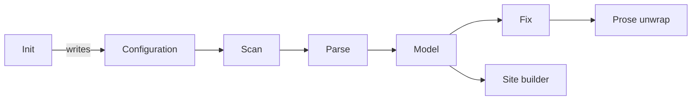

# Engine

<!-- idk-plans:progress:start (generated) -->
◐ 93% (27/29) · 1 deferred
<!-- idk-plans:progress:end -->

The engine does the work behind every command. It reads the files once, and builds a model. Every check, fix, and page comes from that model, so they always agree.

<!-- idk-plans:zoom:start (generated) -->
Zoom in: [Init](./init.md "init") · [Configuration](./config.md "config") · [Scan](./scan.md "scan") · [Parse](./parse.md "parse") · [Model](./model.md "model") · [Fix](./fix.md "fix") · [Site builder](./site.md "site") · [Prose unwrap](./wrap.md "wrap")
<!-- idk-plans:zoom:end -->

## Parts

<!-- idk-plans:children:start (generated) -->
- [Configuration](./config.md "config"): Reads idk-plans.config.json and fills in defaults. It also holds the JSON schema that editors use to check the file. ● 100% (3/3)
- [Scan](./scan.md "scan"): Finds the Markdown files that the configuration includes, and skips the files that it excludes. ● 100% (2/2)
- [Parse](./parse.md "parse"): Reads one Markdown file into facts: frontmatter, tasks, links, diagrams, and generated blocks. It does not look at other files. ● 100% (3/3)
- [Model](./model.md "model"): Joins the parsed files into nodes and trees, calculates every rollup, and finds problems that need more than one file. ● 100% (3/3)
- [Fix](./fix.md "fix"): Writes the parts of each file that the tool owns: generated blocks, link paths, task marks, aliases, and tree tags. ● 100% (4/4)
- [Prose unwrap](./wrap.md "wrap"): Joins prose that is wrapped by hand into one line for each paragraph, so that viewers which show line breaks do not break sentences. ● 100% (2/2) · 1 deferred
- [Site builder](./site.md "site"): Builds a static website from the model, with diagrams that link to pages, a sidebar for each tree, search, and a list of open tasks. ◐ 75% (6/8)
- [Init](./init.md "init"): Writes starter files for a new project. It does not change a file that exists, so you can run it again safely. ● 100% (3/3)
<!-- idk-plans:children:end -->

How it works

[src/index.js](index.js) is the public API. `loadProject` runs configuration, scan, parse, and model, in that order. `check` adds two checks that need the fix step: `stale-generated` and `hard-wrap`. `fix` writes each file that changes.

The engine is plain ES modules for Node.js, with no build step. It has three dependencies: `yaml`, `picomatch`, and `marked` (only for the site).

Why it works this way

`check` finds stale generated blocks by running the fix step and comparing the result. So `check` and `fix` can not disagree about what is current.

## Tasks

- [x] Keep tests for each part, with `node --test`
